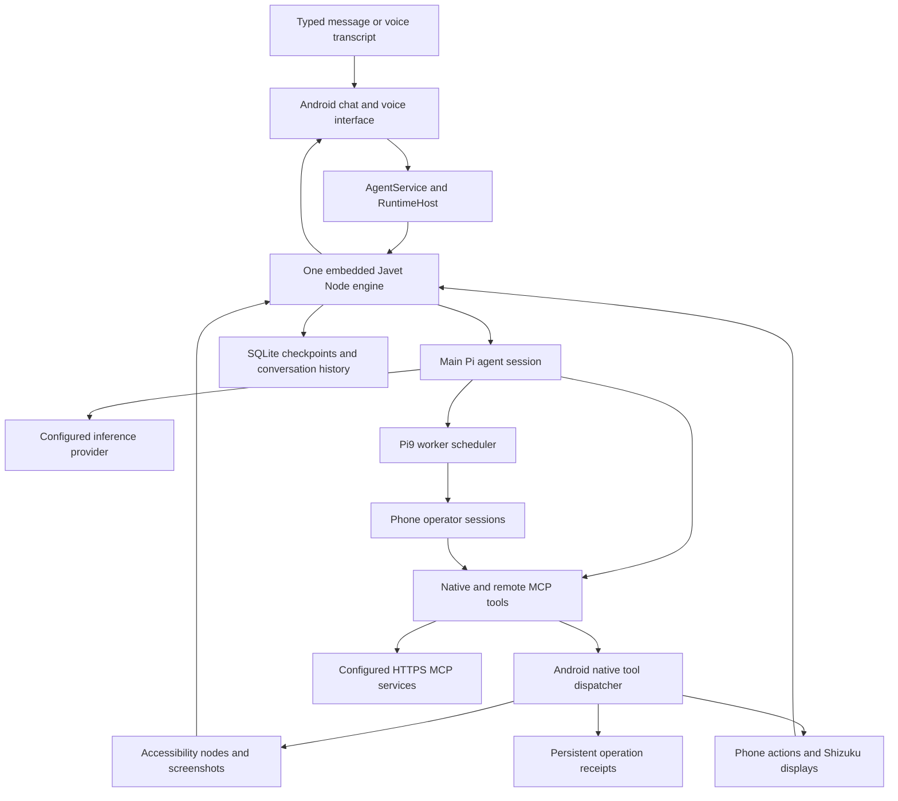

# Pocket Agent foundation review

Prepared on 1 November 2026 for the owner-requested mobile shopping application. Source baseline is upstream `3790d7650aaf73d906d0f21739dc9dbdce010fb6`. The fork is [keptbeetle/pocket-agent](https://github.com/keptbeetle/pocket-agent), with parent [ru-aish/pocket-agent](https://github.com/ru-aish/pocket-agent).

Windows checkout is `D:\Projects\pocket-agent`. Local development branch is `codex/shopping-agent-foundation`. `origin` points to the fork and `upstream` points to ru-aish. The initial fork preserves upstream code and history. This review records setup and inspection before shopping integration.

## How execution works

The Android app packages a local HTML/JavaScript chat UI in a WebView. Its agent runtime runs separately inside Javet's embedded Node engine. Java bridges user requests into `PocketAgent.dispatch`, supplies protected credentials, executes native tools and saves state. Desktop preview shares UI/provider components but lacks Android device tools and workers.

The main conversation can delegate to retained workers through Pi9. These sessions share one engine, a four-worker execution cap and a three-display FIFO pool. User steering and worker completion enter persisted queues. Running work restored after process death becomes interrupted. Tool side effects require outcome inspection before any replay.

Browsing uses a mobile browser or installed app operated through Android tools. `phone_open_url` launches a URL, `phone_observe` returns accessibility nodes and optionally an image, and `phone_act` executes an action against a screen snapshot. Accessibility and Shizuku provide different execution paths. Current source supports ordinary HTTP(S) navigation without a merchant allowlist. The code includes no dedicated shopping search index, merchant verification service or PayPal adapter.

## Source map

| Location | Responsibility | Shopping integration relevance |
| --- | --- | --- |
| `preview/native-app.js`, `preview/native-*.js` | Packaged Android chat and settings interface | Shopping requests, evidence presentation and buyer review |
| `app/.../MainActivity.java`, `PocketWebUi.java` | Android/WebView UI bridge | Entry points and buyer-owned review interactions |
| `app/.../AgentService.java`, `RuntimeHost.java` | Foreground lifecycle, one Node engine, native bridge | Session lifecycle and trusted dispatch boundary |
| `runtime/src/index.ts` | Creates `PocketRuntime` and exposes dispatch | Runtime bootstrap |
| `runtime/src/runtime.ts` | Main session, workers, checkpoint/inbox, tool assembly | Shopping session state and shared policy enforcement |
| `runtime/src/session.ts`, `provider.ts` | Pi model loop, inference adapters and budgets | Model selection and bounded interpretation |
| `runtime/src/tools.ts` | Native tool wrappers, UI readiness, subagent tool | Before-action validation and worker capabilities |
| `runtime/src/prompts.ts` | Main/worker operating instructions | Shopping role and evidence-handling instructions |
| `runtime/src/mcp.ts` | HTTPS Streamable HTTP MCP clients | DealPilot verifier, merchant tools and payment-service connection |
| `app/.../NativeTools.java` | Actual device operation dispatcher | Final native enforcement and fresh screen checks |
| `app/.../OperationStore.java` | Persistent mutation fingerprint/result ledger | Cart action retry and unknown-outcome handling |
| `app/.../StateStore.java`, `ConversationHistory.java` | Runtime checkpoints and searchable history | Restore shopping context and preserve receipts |
| `app/.../CredentialStore.java` | Android Keystore-backed encrypted credentials | Private provider/service authentication |
| `runtime/src/autonomy.ts`, Android autonomy classes | Schedules, wakeups, approvals and background runs | Later shopping follow-ups after explicit policy design |

`app/...` abbreviates `app/src/main/java/dev/pocket/agent/` in this table.

## Important behavior for the proposed strict shopper

- `phone_shell` is deliberately granted to main, researchers and unattended workers. `nativeTools` exempts it from ordinary grant filtering, and `authorizePhone` exempts it from autonomous action approval. Shizuku commands can interact with screens and files outside normal `phone_act` checks. Shopping policy needs enforcement across these entry points before autonomous cart actions are enabled.
- Native mutation receipts and stale-screen checks provide useful foundations, but an accepted tap only establishes dispatch. Seller cart contents, variant, quantity, current price and checkout outcome require independent postcondition checks.
- Remote MCP tools are namespaced and bounded. Interactive main/phone operators can receive them. Researchers and scheduled autonomous runs have narrower availability. Registering a verifier once will require checking each execution path's actual tool grants.
- Native provider modes include scripted validation, OpenAI-compatible routes, Codex account, OpenCode and Nebius. Gemini is currently used by DealPilot's backend. Direct Gemini support in the Android runtime would need its own adapter or a suitable service bridge.
- `StateStore` checkpoints, the operation ledger and model/provider errors should retain their distinct meanings when we add shopping state. Payment approval must bind to the exact source observation, variant, quantity, currency, amount and expiry.
- No merchant allowlist, product identity/stock conflict rules, shopping-only policy or PayPal purchase flow has been implemented in this fork during foundation setup. The next implementation can build on the identified dispatch boundaries and the existing DealPilot backend.

## Local environment

| Layer | Prepared environment |
| --- | --- |
| Windows runtime | Node 22.20.0, npm 10.9.3, lockfile-installed dependencies using `npm ci --ignore-scripts` |
| Windows Android tools | Temurin Java 17, ADB at `D:\sdk\platform-tools\adb.exe`, Android platform 36 and build-tools 36.0.0 present |
| Native build requirements | Gradle wrapper 9.6.1, Android Gradle Plugin 9.4.1, compile/target SDK36, minimum Android12/API31, pinned NDK27.2.12479018 |
| Android gaps | Exact pinned NDK absent locally. ADB reported zero attached devices. APK compilation/signing follows upstream's GitHub Actions workflow |
| Linux test environment | Ubuntu24.04 under WSL, private Node22.22.2 and Java17 toolchains, private Python virtual environment with aiohttp3.13.5 |
| Linux checkout | `/home/keptbeetle/.local/share/dealpilot/pocket-agent-foundation-20261101/repo`, cloned from the Windows checkout at the baseline commit |

The WSL tools live under the same `pocket-agent-foundation-20261101/tools` directory. Node and Java archives are checked against their published SHA-256 values. No system package replacement is required. After future local commits, update the Linux checkout from its Windows `origin` before testing those changes. Uncommitted Windows edits are absent from that checkout.

Windows runtime commands from `D:\Projects\pocket-agent\runtime` are `npm test`, `npm run build` and `npm run test:ui`. The bundle build emits Android assets. Upstream README directs APK compilation/signing through GitHub Actions. The Android workflow includes a disposable validation-signing option, and a fork needs its own build/signing configuration. No workflow was dispatched during this setup.

For Linux tests, export the private tool directories into the shell's PATH, then run the same npm commands from the Linux checkout. Run repository Python tests using the private virtual environment and Java17 on PATH. Private setup scripts and logs are saved under Windows `artifacts/foundation-20261101` and WSL `pocket-agent-foundation-20261101/logs`.

## Verification and provenance

- Windows core runtime passed **204/204 tests**, including scripted agent execution, workers, grants, memory, MCP, cancellation, shell and session-budget cases.
- Windows runtime bundle built successfully at **802,304 bytes**, gzip **214,641 bytes**. These values describe JavaScript output.
- Windows desktop preview passed **12/28 tests**. Failing tests include Unix permission expectations and directory-fsync behavior. Original logs remain in the ignored artifacts directory.
- The identical source's preview suite passed **28/28 tests under WSL/Linux** with Node22.22.2. Product code and assertions were retained.
- Windows Python tooling initially failed three of twenty cases involving private-file permissions and `/bin/sh`. Linux initially lacked Java. Original failures and subsequent environment checks remain preserved. After installing private Java17 in WSL, all **20/20 repository Python tests passed**.
- Native Android execution, merchant shopping and PayPal have not been exercised in this foundation task. No model account credentials were imported.

The upstream repository has no root license. `THIRD_PARTY_NOTICES.md` describes multiple dependency licenses and unresolved grants over reused Android control code. Fork provenance and existing notices are retained. Distribution rights need resolution alongside the later release work.

Historical DealPilot milestone bars are Phase1 50/50, automated Phase2 40/40 and Phase3 3/10, total93/100. This mobile foundation task changes each by zero. Phase3 release and its preserved stash remain paused.
